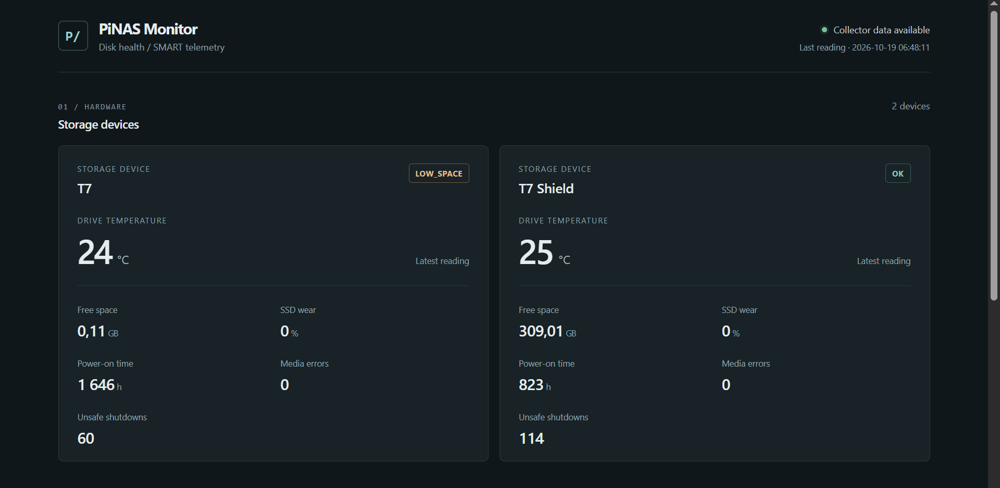
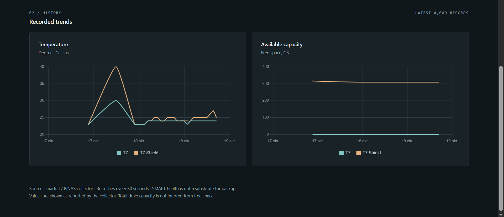

# PiNAS Monitor

A disk-health dashboard for a Raspberry Pi NAS. A Python script reads SMART data from the SSDs every hour and appends it to a CSV file. A Flask web page shows the latest readings and history from that file.

  




## Background

I have a cheap and small Raspberry Pi 3 NAS setup for my photos and files. Checking the SSDs meant SSHing in and reading through smartctl output, which is mildly inconvinient. So now a script logs the SMART values to a CSV every hour, and a Flask page shows them.

It's monitoring only, not a backup. Keep a second copy of anything you care about.

If you want full-featured disk monitoring, [Scrutiny](https://github.com/AnalogJ/scrutiny) does much more. I wanted something small enough to read in one sitting and change myself, with history stored as plain CSV and Flask as the only dependency.

## Features

For each drive, the dashboard shows:

- SMART status and temperature
- NVMe wear level and available spare
- Power-on hours, media errors and unsafe shutdowns
- Free space on the mounted filesystem
- Temperature and free-space charts, from the last 4,000 CSV rows

It shows a warning if a disk isn't mounted, free space is low, temperature or wear is high, or SMART reports a problem. The page reloads every 60 seconds and marks the data as stale if the newest row is more than two hours old.

Some values may be missing, depending on the drive and the USB adapter.

## How it works

```text
SSDs
   │
   ▼
smartctl -a -j          read-only SMART query
   │
   ▼
pinas-smart.py          run hourly by pinas-smart.timer
   │
   ▼
history.csv             one row per drive per run
   │
   ▼
app.py                  Flask app (/ and /api/history)
   │
   ▼
Browser                 http://127.0.0.1:8765
```

The collector and the dashboard run as separate processes. The collector keeps writing to the CSV when the dashboard is stopped.

## Files

| File | Purpose |
| --- | --- |
| `app.py` | Flask dashboard and history API |
| `pinas-smart.py` | Collector script. This is the one I run on my NAS, with my disk paths replaced by examples |
| `deploy/pinas-smart.service.example` | systemd service that runs the collector once |
| `deploy/pinas-smart.timer.example` | systemd timer that starts the collector every hour |
| `deploy/pinas-monitor.service.example` | systemd service for the dashboard |
| `requirements.txt` | Python dependencies (Flask) |

Drives are configured in the `DRIVES` dictionary at the top of `pinas-smart.py`. There is no separate config file.

## Requirements

- Raspberry Pi OS or another Debian-based Linux
- Python 3 and a recent version of `smartmontools`
- One or more mounted disks on a USB adapter that supports SMART passthrough
- `sudo` access
- Internet access to install packages, and for the dashboard to load Chart.js from its CDN

**Supported hardware:** the collector was written for NVMe SSDs connected through an ASMedia USB bridge (`smartctl -d sntasmedia`). Other adapters may need `-d auto`, `-d sat` or another mode. SATA drives don't report `nvme_smart_health_information_log`, so supporting them would require changes to the parsing code.

## Installation

These steps are for a new install. If your Pi already has a working collector and timer, back them up before replacing anything, or skip the collector steps.

### 1. Install packages and clone the repo

```bash
sudo apt update
sudo apt install -y python3 python3-venv git smartmontools

cd ~
git clone https://github.com/aimeon/pinas-monitor.git
cd pinas-monitor
python3 -m venv .venv
.venv/bin/pip install -r requirements.txt
```

If you downloaded the release ZIP, extract it to `~/pinas-monitor` instead.

### 2. Find your disks

```bash
lsblk -o NAME,MODEL,SIZE,FSTYPE,MOUNTPOINTS
ls -l /dev/disk/by-id/
findmnt
```

Mount your disks before continuing, for example through `/etc/fstab`. The collector does not mount, partition or format disks. Don't format a disk that has data on it.

Check that SMART data can be read through your adapter:

```bash
sudo smartctl -a -j -d sntasmedia /dev/sdX
```

Replace `/dev/sdX` with your drive. If this fails, try `-d auto` or check the `smartctl` documentation for your USB bridge.

Device names like `/dev/sda` can change after a reboot, while paths under `/dev/disk/by-id/` stay the same. The by-id paths usually include the drive's serial number, so use them on the Pi but don't commit them to Git.

### 3. Configure and install the collector

`pinas-smart.py` starts with this example config:

```python
DRIVES = {
    "Disk 1": {
        "device": "/dev/sda",
        "mount": "/mnt/disk1",
        "smartctl_type": "sntasmedia",
    },
}
```

- `"Disk 1"`: name shown on the dashboard
- `device`: the disk, preferably as a `/dev/disk/by-id/...` path
- `mount`: the disk's mount point (see `findmnt`)
- `smartctl_type`: the value you used with `smartctl -d` in step 2

Add one entry for each disk.

Install the script, edit the installed copy with your real values, and run it once. The copy in the repo should keep the example values.

```bash
sudo install -d -m 0755 /var/log/pinas-smart
sudo install -m 0755 pinas-smart.py /usr/local/bin/pinas-smart.py
sudo nano /usr/local/bin/pinas-smart.py
sudo python3 /usr/local/bin/pinas-smart.py
sudo head -n 3 /var/log/pinas-smart/history.csv
```

The CSV should contain a header and one row for each configured disk. Every run adds one row per disk.

`smartctl` can exit with a nonzero code when it reports a SMART warning, even if the JSON output is valid. The collector reads the JSON in either case.

### 4. Test the dashboard

```bash
cd ~/pinas-monitor
.venv/bin/python app.py
```

On the Pi, open http://127.0.0.1:8765.

To view it from another computer, run this SSH tunnel on that computer:

```bash
ssh -L 8765:127.0.0.1:8765 YOUR_USERNAME@YOUR_PI_IP
```

Then open http://127.0.0.1:8765 on that computer.

The dashboard has no password or login, so it only listens on localhost by default. Don't expose it to the internet.

Stop the test server with `Ctrl+C` before setting up the systemd service in step 6.

### 5. Schedule hourly collection

```bash
cd ~/pinas-monitor
sudo install -m 0644 deploy/pinas-smart.service.example /etc/systemd/system/pinas-smart.service
sudo install -m 0644 deploy/pinas-smart.timer.example /etc/systemd/system/pinas-smart.timer
sudo systemctl daemon-reload
sudo systemctl enable --now pinas-smart.timer
sudo systemctl start pinas-smart.service
```

Check the schedule and the last run:

```bash
systemctl list-timers pinas-smart.timer
systemctl status pinas-smart.service
journalctl -u pinas-smart.service -n 30 --no-pager
```

### 6. Start the dashboard at boot

The example service file has a `YOUR_USERNAME` placeholder and expects the virtual environment at `~/pinas-monitor/.venv`. This command fills in your username and installs the service:

```bash
cd ~/pinas-monitor
sed "s/YOUR_USERNAME/$(id -un)/g" deploy/pinas-monitor.service.example | \
  sudo tee /etc/systemd/system/pinas-monitor.service > /dev/null
sudo systemctl daemon-reload
sudo systemctl enable --now pinas-monitor.service
sudo systemctl status pinas-monitor.service
```

If you installed the project somewhere other than `~/pinas-monitor`, change `WorkingDirectory` and `ExecStart` in the installed service file. The user running the dashboard needs read access to the history CSV.

## Configuration

Defaults, as used on my NAS:

| Setting | Default |
| --- | --- |
| Drives | `DRIVES` in `pinas-smart.py` |
| History file | `/var/log/pinas-smart/history.csv` |
| Low free space | below 5% |
| High temperature | 65 °C or above |
| High wear | NVMe `percentage_used` of 90% or above |
| Media errors | more than 0 |
| Collection interval | hourly (`pinas-smart.timer`) |
| Dashboard host | `PINAS_HOST`, default `127.0.0.1` |
| Dashboard port | `PINAS_PORT`, default `8765` |
| Dashboard CSV path | `PINAS_CSV`, default `/var/log/pinas-smart/history.csv` |

The `PINAS_*` environment variables are read by the dashboard only. The collector's output path is set by `LOG` in `pinas-smart.py`. If you move the CSV, update both.

CSV columns:

```csv
timestamp,drive,temperature_c,wear_pct,spare_pct,power_on_hours,unsafe_shutdowns,media_errors,free_gb,status
```

The collector and dashboard only read from the disks. The history CSV is the only file either of them writes.

## Troubleshooting

**The dashboard shows no history.**
Check that `/var/log/pinas-smart/history.csv` exists (`ls -l`), run `sudo systemctl start pinas-smart.service`, and make sure the dashboard user can read the file.

**`SMART_UNAVAILABLE` or empty values.**
Run `sudo smartctl -a -j -d sntasmedia /dev/sdX` with your disk and device type, and check that the output contains `nvme_smart_health_information_log`. If it doesn't, your adapter likely needs a different `-d` mode.

**`NOT_MOUNTED`.**
Run `findmnt` with your mount path and fix the `DRIVES` entry if it's wrong. When a mount is missing, the collector reports `NOT_MOUNTED` instead of the root filesystem's free space.

**Charts are missing.**
Chart.js is loaded from a CDN. If the browser can't reach it, download Chart.js and change the script tag in `app.py` to point to the local file.

**Data is marked stale.**
This happens when the newest row is more than two hours old. Check `systemctl list-timers pinas-smart.timer` and `journalctl -u pinas-smart.service -n 30 --no-pager`.

**The dashboard isn't reachable from another computer.**
It only listens on localhost. Use the SSH tunnel from step 4 instead of opening port 8765.

## Privacy

If you publish a fork, leave these out of the repo:

- A `pinas-smart.py` containing `/dev/disk/by-id/...` paths, which can include SSD serial numbers
- Your history CSV and SMART output
- IP addresses, credentials and your actual systemd files

The `.gitignore` excludes CSV files, logs, local environment files and editor files. Check `git diff --cached` before pushing.

## Limitations

SMART doesn't always warn before a drive fails, and SMART support over USB differs between adapters. Keep backups.

## License

MIT. See [LICENSE](LICENSE).